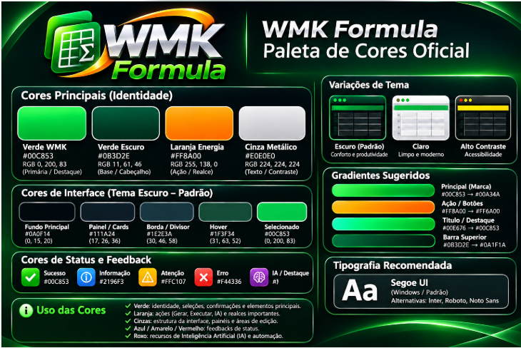

# WMK Formula — Planilhas inteligentes para todos

**WMK Formula** é uma personalização do projeto [GridCraft](https://github.com/storytold/gridcraft), combinando um motor de planilhas em **Rust** com uma plataforma experimental de desenvolvimento em **HTML, CSS e JavaScript**. O objetivo é permitir que usuários criem formulários, cadastros, automações e ferramentas próprias para trabalhar com planilhas — sem precisar de VBA.

> **Estado atual:** desenvolvimento experimental. O motor WMK Formula 0.16.0 foi testado com o WMK Web Designer v0.5.2; não se trata de uma versão estável ou de substituição completa do Excel.

## Comece aqui

- **[Manual completo em português](docs/wmk/manual-completo.html)** — visão geral, arquitetura, exemplos, testes e limitações.
- **[Primeiro contato](docs/wmk/inicio.html)** — instalação e teste.
- **[Form Designer](docs/wmk/designer.html)** — montagem de formulários no navegador.
- **[CRUD / DataGrid](docs/wmk/crud.html)** — incluir, editar, localizar e remover dados em planilhas.
- **[Monaco e JavaScript](docs/wmk/javascript.html)** — programação e acesso à API local.
- **[Componentes personalizados](docs/wmk/componentes.html)** — extensão prevista e conceitos para criar novos controles.
- **[Plugins, Skills, MCP e IA](docs/wmk/plugins.html)** — arquitetura proposta; não são recursos concluídos.
- **[Licenciamento](docs/wmk/licenciamento.html)** — direitos e atribuições.

## O que já foi demonstrado

| Recurso | Situação |
|---|---|
| Motor de planilhas WMK Formula baseado no GridCraft | Existente, em Rust |
| Bridge HTTP local para leitura/escrita de células | Testada em Windows |
| Monaco executando JavaScript contra a Bridge | Testado em Windows |
| Form Designer independente (HTML/CSS/JS) | Testado em Windows |
| DataGrid com CRUD simples de linhas de planilha | Testado em Windows, limitado |
| TextBox, TextArea, CheckBox, ComboBox no CRUD | Testados em Windows |
| Formatação programática, IA, MCP, plugins instaláveis | Planejados, não concluídos |

## Testar o Web Studio

Os fontes da aplicação web e do servidor Bridge encontram-se em **[`wmk-web-studio/`](wmk-web-studio/)**. O motor Rust precisa ter sido compilado separadamente.

No Windows, com o motor em `D:\Ferramentas\gridcraft\target\debug\WMK-Formula.exe`:

1. Extraia este repositório localmente.
2. Entre em `wmk-web-studio` e execute `INICIAR-WMK.cmd`.
3. Abra o endereço local mostrado pelo inicializador e comece pelo Designer.

**Segurança:** a Bridge destina-se ao uso local. Não exponha a porta na internet; execute scripts de fontes confiáveis e teste o CRUD em planilhas descartáveis. As operações simples de célula não constituem transações de banco de dados.

## Identidade visual oficial

Use estas imagens originais em materiais do WMK Formula. A licença do código não concede automaticamente direitos sobre as marcas ou logotipos.

## Código aberto e atribuições

**Personalização e documentação WMK:** Walney Moreira Klein — **walneyk@hotmail.com**.

**Projeto de origem:** [GridCraft, da comunidade ArtCraft](https://github.com/storytold/gridcraft). Os créditos, avisos de copyright e licenças do GridCraft e de suas dependências devem ser preservados. Consulte `LICENSE-APACHE`, `LICENSE-MIT`, `NOTICE`, `ATTRIBUTION.md` do projeto original e os avisos presentes no código. Não substitua esses arquivos pelos avisos do Web Studio.

O Web Studio possui arquivos de licenciamento e atribuição próprios em [`wmk-web-studio/`](wmk-web-studio/). Cada contribuição ou arquivo de terceiro deve ser tratado conforme seus respectivos direitos.

## Contribua

Correções, novos componentes, exemplos, documentação e sugestões são bem-vindos. Consulte os manuais, respeite os autores originais e explique as alterações propostas. O objetivo é compartilhar conhecimento e permitir que outras pessoas desenvolvam suas próprias ferramentas para a planilha.
