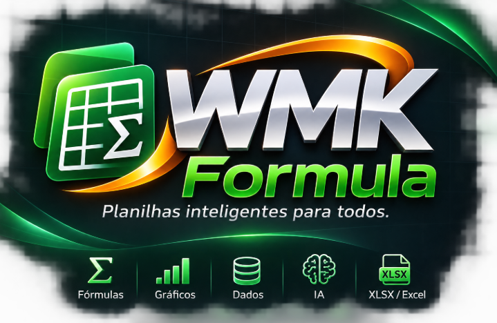
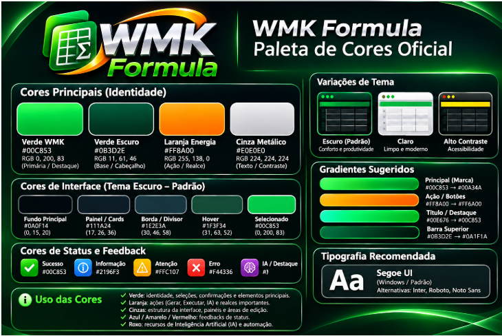

# WMK Formula — Open Web Designer e Bridge

**Versão publicável preparada:** `v0.5.2-docs1` (base funcional v0.5.2; atualização de documentação, licença e identidade visual).

**Manual completo:** [Como foi feito e o que você pode criar](manuais/manual-completo.html).

> Crie formulários em HTML/CSS/JS e use JavaScript para alimentar planilhas reais pelo motor WMK Formula (Rust), sem depender de VBA.

**Créditos das contribuições WMK:** Walney Moreira Klein — walneyk@hotmail.com.
**Créditos do motor anterior:** GridCraft, ArtCraft Team e colaboradores. Consulte `licencas/`.

## O que funciona

- Bridge HTTP local com autenticação e acesso à planilha Rust por protocolo de controle.
- Code Studio com Monaco (carregamento CDN/fallback) e execução JS experimental.
- Form Designer com componentes, propriedades, JSON, DataGrid e CRUD limitado de planilha.
- TextBox, TextArea, CheckBox e ComboBox, incluindo gravação e recuperação de campos.

## Comece aqui (Windows)

1. Extraia os arquivos em `D:\Ferramentas\WMK-Bridge`.
2. Tenha o motor WMK Formula compilado em `D:\Ferramentas\gridcraft\target\debug\WMK-Formula.exe`.
3. Abra `INICIAR-WMK.cmd`.
4. Designer: <http://127.0.0.1:8773/designer.html> · Code Studio: <http://127.0.0.1:8773/>.

**Atenção:** a Bridge só escuta em localhost. Não exponha essas portas em rede pública. Faça testes com planilhas descartáveis; o CRUD não usa transações e compacta apenas colunas mapeadas.

## 📚 Manuais completos em HTML (pt-BR)

| Guia | Conteúdo |
|---|---|
| [Primeiro contato](manuais/inicio.html) | Instalação, arquitetura e testes iniciais |
| [Form Designer](manuais/designer.html) | Canvas, controles, propriedades, salvar e executar |
| [CRUD e planilha](manuais/crud.html) | Cadastrar, localizar, editar, remover e limitações |
| [Monaco e JavaScript](manuais/javascript.html) | SDK e API atual com exemplos reais |
| [Criando componentes](manuais/componentes.html) | Arquitetura proposta para componentes derivados |
| [Plugins, IA, Skills e MCP](manuais/plugins.html) | Proposta de extensibilidade e segurança |
| [Licenças e créditos](manuais/licenciamento.html) | Direitos e obrigações |
| [Publicando no GitHub](manuais/publicacao.html) | Guia passo a passo |

Abra `manuais/inicio.html` diretamente no navegador, mesmo offline.

## Estado do projeto

✅ Comunicação HTML ↔ Rust e CRUD experimental testados pelo usuário no Windows.
⚠️ Esta atualização de documentação/identidade não foi novamente testada no computador do usuário.
🧭 Plugin SDK, bancos SQL, agentes IA, MCP e tabelas dinâmicas são roadmap, não funções disponíveis.

## Licença e atribuição

Contribuições originais WMK: **Apache License 2.0**, conforme `LICENSE`, preservados os avisos aplicáveis em `NOTICE`.
O motor Rust NÃO está incluído neste repositório; os materiais de referência de sua licença estão em `licencas/`. Bibliotecas de terceiros mantêm suas próprias licenças.

## Segurança

A Bridge atual é experimental e local. Não execute scripts de pessoas desconhecidas, não inclua tokens no GitHub e não use em produção sem revisão de segurança e testes.

## Manual completo

Abra `manuais/manual-completo.html` para entender como foi construído, como usar, desenvolver componentes e quais recursos ainda estão planejados.
